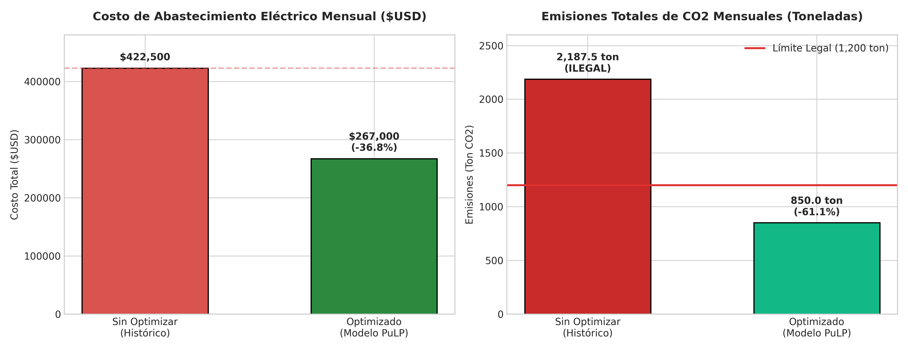
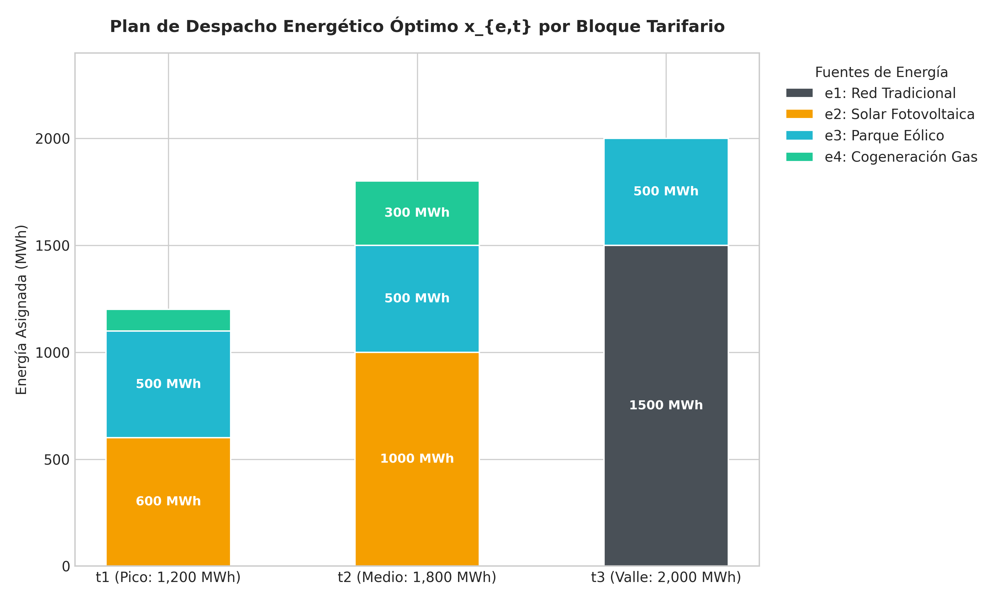
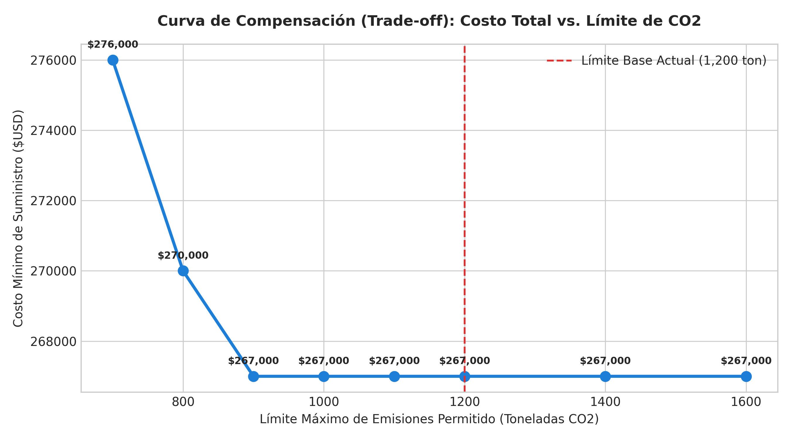

# Optimización de Mezcla Energética y Descarbonización Industrial Multi-Bloque

[](https://www.python.org/)
[](https://coin-or.github.io/pulp/)
[](LICENSE)
[](https://www.uniguajira.edu.co/)

> **Proyecto de Investigación de Operaciones + Desarrollo Tecnológico + IA**  
> **Programa Académico:** Ingeniería de Sistemas  
> **Institución:** Universidad de La Guajira (Facultad de Ingeniería)  
> **Docente:** Prof. Nicolás de Jesús Sánchez  
> **Integrantes / Autores:**  
> - Sneyder Joaquín Madrid Arcia  
> - Moisés Bolívar  
> - Andrés Aguilar  
> - Dylan David Cáceres Montiel  
> - Milder Oñate  
> - Jorge Escudero  
> - William Redondo  
> **Fecha:** Noviembre de 2026  

---

## 📌 Descripción del Problema
Una planta industrial electrointensiva requiere planificar su compra y suministro de energía eléctrica mensual (**5,000 MWh total**) distribuida en tres bloques tarifarios:
* **Bloque Pico ($t_1$):** 1,200 MWh
* **Bloque Medio ($t_2$):** 1,800 MWh
* **Bloque Valle ($t_3$):** 2,000 MWh

Se dispone de cuatro fuentes de suministro con costos variables y factores de emisión diferenciados:
1. **$e_1$: Red Tradicional** ($110/$85/$60 USD/MWh | Capacidad ilimitada | 500 kg CO$_2$/MWh)
2. **$e_2$: Solar Fotovoltaica** ($45/$45/$0 USD/MWh | Capacidad: 600/1000/0 MWh | 0 kg CO$_2$/MWh)
3. **$e_3$: Parque Eólico** ($50/$50/$50 USD/MWh | Capacidad: 500 MWh/bloque | 0 kg CO$_2$/MWh)
4. **$e_4$: Cogeneración Gas Natural** ($75/$75/$75 USD/MWh | Capacidad: 800 MWh/bloque | 250 kg CO$_2$/MWh)

### Restricciones Ambientales y Regulatorias
* **Límite de Emisiones:** $\le 1,200$ toneladas métricas de CO$_2$ al mes ($1,200,000$ kg).
* **Cuota Mínima Renovable:** Solar + Eólica $\ge 30\%$ del consumo total ($\ge 1,500$ MWh).

---

## 📊 Comparación Cuantitativa de Resultados

| Métrica de Evaluación | Escenario Histórico (Sin Optimizar) | Escenario Optimizado (PuLP / CBC) | Ahorro / Mejora Absoluta | Mejora Porcentual (%) |
| :--- | :---: | :---: | :---: | :---: |
| **Costo Total Mensual** | **$422,500.00 USD** | **$267,000.00 USD** | **-$155,500.00 USD** | **-36.80% (Ahorro)** |
| **Emisiones Totales CO$_2$** | **2,187.50 Toneladas** | **850.00 Toneladas** | **-1,337.50 Toneladas** | **-61.14% (Reducción)** |
| **Consumo Renovable** | 0.0 MWh (0.0%) | 3,100.0 MWh (62.0%) | +3,100.0 MWh | **+62.0 puntos %** |
| **Límite Legal (1,200 ton)** | 2,187.50 Ton | 850.00 Ton | Margen de 350 ton | **Conformidad Estricta** |
| **Estado Regulatorio** | **ILEGAL (+82.3% Infracción)** | **CUMPLIMIENTO TOTAL** | Multas suprimidas | **100% Blindaje Legal** |

---

## 📈 Matriz de Abastecimiento Energético Óptimo ($x_{e,t}$)

```
================================================================================
MATRIZ DE ASIGNACIÓN ÓPTIMA (MWh):
Bloque                  t1 (Pico)  t2 (Medio)  t3 (Valle)   Total Fuente
Fuente                                                   
e1: Red Tradicional           0.0         0.0      1500.0     1,500.0 MWh (30%)
e2: Solar Fotovoltaica      600.0      1000.0         0.0     1,600.0 MWh (32%)
e3: Parque Eólico           500.0       500.0       500.0     1,500.0 MWh (30%)
e4: Cogeneración Gas        100.0       300.0         0.0       400.0 MWh  (8%)
--------------------------------------------------------------------------------
Demanda Satisfecha        1,200.0     1,800.0     2,000.0     5,000.0 MWh (100%)
Costo por Bloque (y_t)  $59,500.0   $92,500.0  $115,000.0    $267,000.00 USD
================================================================================
```

---

## 📉 Visualizaciones Generadas

| Comparación Costos y Emisiones | Despacho Óptimo por Bloque | Análisis de Sensibilidad CO$_2$ |
| :---: | :---: | :---: |
|  |  |  |

---

## 🚀 Instalación y Ejecución

### 1. Clonar el repositorio
```bash
git clone https://github.com/dvzinx22/optimizacion-mezcla-energetica.git
cd optimizacion-mezcla-energetica
```

### 2. Crear y activar entorno virtual (opcional pero recomendado)
```bash
python -m venv venv
# En Windows:
venv\Scripts\activate
# En Linux/macOS:
source venv/bin/activate
```

### 3. Instalar dependencias
```bash
pip install -r requirements.txt
```

### 4. Ejecutar el modelo de optimización
```bash
python optimizacion_energia.py
```

El script ejecutará el solver PuLP CBC, imprimirá el reporte ejecutivo en consola y generará:
* `matriz_abastecimiento.xlsx`: Datos detallados y análisis dual exportado a Excel.
* `comparacion_escenarios.csv`: Resumen de métricas operativas.
* `comparacion_costos_emisiones.png`, `matriz_despacho_energia.png`, `analisis_sensibilidad.png`: Gráficos en alta resolución.

---

## 📄 Documentación Académica y LaTeX
* El archivo fuente con las 17 secciones completas para compilar en Overleaf o TeXstudio se encuentra en:  
  👉 [`informe_ejercicio1_optimizacion_energia.tex`](informe_ejercicio1_optimizacion_energia.tex)
* Versión en Markdown para lectura rápida:  
  👉 [`INFORME_FINAL_OPTIMIZACION_ENERGETICA.md`](INFORME_FINAL_OPTIMIZACION_ENERGETICA.md)

---

## 👨‍🏫 Créditos y Autoría
* **Estudiante:** dvzinx22 (Ingeniería de Sistemas - Universidad de La Guajira)
* **Profesor:** Nicolás de Jesús Sánchez
* **Materia:** Investigación de Operaciones + Desarrollo Tecnológico + IA
